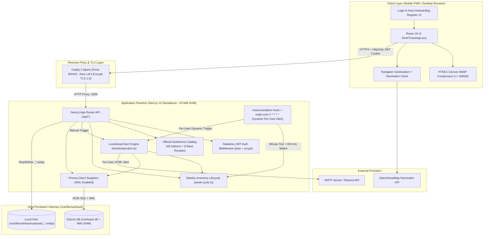
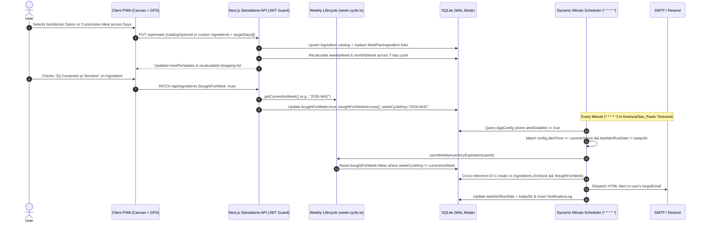
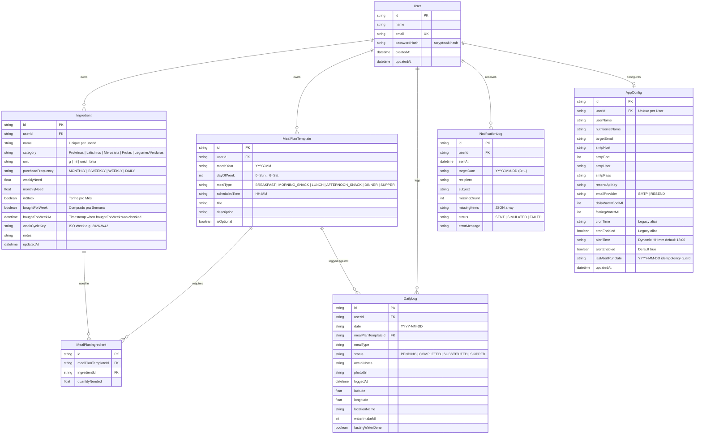

# Software Design Document (SDD) — NutriTrack-OS

- **Document ID:** `SDD-001-NUTRITRACK-OS` / `SDD-002-MULTI-USER-AUTH` / `SDD-003-DYNAMIC-MENU-INVENTORY-LIFECYCLE`
- **Version:** `3.0.0`
- **Status:** `Approved / Released`
- **Methodology:** Spec-Driven Development (SDD)

---

## 1. System Overview & Context

### 1.1. Purpose
**NutriTrack-OS** is a reactive, low-footprint multi-user full-stack web application designed to manage cyclic meal plans (including the complete 48-option Official Nutritionist PDF Catalog and 8 Base Recipes), personal food inventory with automatic ISO-week shopping expiration, daily nutritional adherence (with geolocated photo evidence and hydration tracking), proactive lookahead grocery alerts with user-configurable schedule times, and custom-period clinical reporting for nutritionists. Each registered user operates in an isolated tenant workspace (`userId`).

### 1.2. System Actors & External Integrations
- **Authenticated User (Patient / Athlete):** Registers or logs in via stateless JWT session (`nutritrack_session`), manages daily water intake, logs meals with camera photos and GPS location, selects from 48 official nutritionist options or creates custom multi-day meals, and tracks monthly/weekly grocery stock checkboxes in complete isolation from other users.
- **Nutritionist (Clinical Reviewer):** Consumes the consolidated executive report filtered by any custom date range (`startDate` to `endDate` or quick presets) with adherence KPIs, meal-type breakdown, hydration average, substitution justifications, and timestamped/geolocated meal photo gallery via web view or printable PDF (`window.print()`).
- **Multi-Tenant Dynamic Lookahead Cron Engine (Internal Actor):** Scheduled background worker (`node-cron` ticking every minute in `America/Sao_Paulo` timezone) that evaluates each user's configured `alertTime` (`HH:mm`), automatically expires stale weekly purchases (`weekCycleKey !== currentIsoWeek`), and dispatches `D+1` missing-ingredient alerts at most once per day (`lastAlertRunDate`).
- **OpenStreetMap Nominatim API (External Service):** Provides client-side reverse geocoding (`lat/lon` $\rightarrow$ neighborhood/city label) during meal check-in.
- **SMTP / Resend API (External Service):** Delivers per-user transactional HTML alert emails when ingredients required for tomorrow's meals are out of stock.

---

## 2. Architecture & Component Design

### 2.1. High-Level Container & Component Topology

### 2.2. Sequence Diagram — Multi-User Auth, Weekly Expiry & Dynamic Lookahead Alert Flow

---

## 3. Data Model Specification (ERD)

The multi-tenant relational schema is managed via Prisma ORM (`prisma/schema.prisma`) on top of SQLite in WAL mode:

---

## 4. Core Business Rules & Algorithms (Specs)

### `SPEC-01`: Lookahead Inventory Alert Engine (`src/lib/lookahead-alert.ts`)
- **Trigger:** Executed automatically by `node-cron` when `America/Sao_Paulo` time matches `AppConfig.alertTime` (default `18:00`) and `AppConfig.alertEnabled == true`, or manually via `POST /api/alerts/check`.
- **Algorithm:**
  1. Run `syncWeeklyInventoryExpiration(userId)` first so any `boughtForWeek` flags from a previous ISO week are automatically cleared before checking tomorrow's meals.
  2. Given `userId` and reference date $D$, compute target date $D_{+1} = D + 1\text{ day}$, its `monthYear` (`YYYY-MM`), and its `dayOfWeek` $\in \{0..6\}$.
  3. Fetch all `MealPlanTemplate` records matching `(userId, monthYear, dayOfWeek)` ordered by `scheduledTime ASC`, including their `MealPlanIngredient` links and associated `Ingredient` entities.
  4. Filter linked ingredients where:
     $$\neg \text{inStock} \land \neg \text{boughtForWeek}$$
  5. Aggregate `quantityForTomorrow` per missing ingredient across all meals of $D_{+1}$ and list the affected meal titles/times.
  6. Render a responsive HTML email table and dispatch via the user's configured provider (`SMTP` via `nodemailer` or `RESEND` via REST API). If credentials are not yet populated, record as `SIMULATED` and return the HTML preview to the UI.
  7. Persist an immutable audit entry in `NotificationLog` linked to `userId`.

### `SPEC-02`: Client-Side Media & Geo Pipeline (`src/components/NutriTrackApp.tsx`)
- **Image Compression Algorithm (`compressImageToWebP`):**
  1. Load user-selected image file into an HTML5 `Image` object via `FileReader`.
  2. Downscale dimensions proportionally so that $\max(\text{width}, \text{height}) \le 1200\text{ px}$ on an offscreen `<canvas>`.
  3. Encode canvas content to `image/webp` starting at quality $q = 0.82$.
  4. Iteratively decrement $q$ by $0.10$ (down to a floor of $0.35$) until the base64 byte payload satisfies:
     $$\text{Size}_{\text{WebP}} \le 390\text{ KB}$$
  5. Upload compressed payload to `POST /api/uploads`, which enforces a hard server-side ceiling of $500\text{ KB}$ and writes `<userId>_<timestamp>.webp` to `UPLOAD_DIR`.
- **Geolocation & Reverse Geocoding:**
  1. Invoke `navigator.geolocation.getCurrentPosition` with `enableHighAccuracy: true`.
  2. Query `https://nominatim.openstreetmap.org/reverse?format=jsonv2&lat={lat}&lon={lon}`.
  3. Extract `suburb || neighbourhood || city_district` and `city || municipality` to form a human-readable badge (or allow 1-tap selection from preset tags: `Casa`, `Trabalho`, `Pós-Treino / Academia`, `Restaurante`).

### `SPEC-03`: Dynamic Grocery Recalculation (`src/lib/seed-data.ts`)
- Whenever a `MealPlanTemplate` or its `MealPlanIngredient` links are created or updated (`POST /api/meals` or `PUT /api/meals`) for a given `(userId, monthYear)`:
  1. Query all `MealPlanTemplate` records for `(userId, monthYear)` across all 7 days of the week ($0..6$).
  2. Sum `quantityNeeded` per `ingredientId` to compute the exact weekly demand:
     $$\text{weeklyNeed}_i = \sum_{m \in \text{Week}} \text{quantityNeeded}_{m,i}$$
  3. Compute the monthly demand as:
     $$\text{monthlyNeed}_i = 4 \times \text{weeklyNeed}_i$$
  4. Persist updated `weeklyNeed` and `monthlyNeed` values in `Ingredient` for that `userId` (setting `0` for any ingredient no longer linked to any meal in the active cycle).

### `SPEC-04`: Stateless Authentication & Auto-Onboarding (`src/lib/auth.ts` & `src/app/api/auth/*`)
- Passwords are hashed using Node.js native `crypto.scryptSync` (`scrypt:<saltHex>:<keyHex>`).
- Upon registration (`POST /api/auth/register`), `provisionInitialUserData(userId)` runs inside an atomic Prisma transaction (`prisma.$transaction`) to populate the new user's isolated 39 catalog ingredients, 42 weekly meal templates, and `AppConfig`.
- Session state is carried in an `HttpOnly`, `Secure`, `SameSite=Lax` JWT cookie (`nutritrack_session`, 30-day validity) signed with `HS256` via `jose`.

### `SPEC-05`: Multi-Tenant Data Isolation (`userId` Guard)
- Every protected API route invokes `getAuthenticatedUser(req)` and returns `401 Unauthorized` if no valid session exists.
- Every Prisma query and mutation on `Ingredient`, `MealPlanTemplate`, `DailyLog`, `NotificationLog`, and `AppConfig` is strictly scoped by `userId: currentUser.id`.

### `SPEC-06`: Multi-User Lookahead Cron Loop (`src/instrumentation.ts`)
- The background cron job queries all registered `User` accounts and their `AppConfig`, executing `runLookaheadCheck(user.id)` independently for each user whose alert schedule is active.

### `SPEC-07`: Authentication UI/UX & Tenant Identification (`src/components/NutriTrackApp.tsx`)
- Unauthenticated visitors are presented with a Mobile-First Login / Register screen featuring instant auto-onboarding feedback.
- Authenticated sessions display the logged-in user's name and email badge in the top navigation bar alongside a 1-click **Sair (Logout)** button, and dynamically inject the user's name into the Nutritionist Executive Report.

### `SPEC-08`: Official Nutritionist Catalog (PDF 1:1) & Custom Multi-Day Meal Builder (`src/lib/nutritionist-catalog.ts` & `src/lib/recipes.ts`)
- Embeds all **48 official meal options** from the Nutritionist's PDF across all 6 daily meal slots (6 Breakfast, 3 Morning Snack, 12 Lunch, 10 Afternoon Snack, 9 Dinner, 8 Supper) and all **8 official base recipes** from Page 13 of the PDF (*Molho de Tomate Caseiro, Lasanha de Berinjela, Purê Saudável, Patê Fit, Pizza de Frigideira com Rap 10, Massa de Panqueca, Hambúrguer Natural, Panqueca de Banana*).
- Users can switch any meal slot via the **"Escolher Opção Oficial da Nutricionista (PDF)"** dropdown or click **"✨ Personalizar / Criar Prato"** to customize the dish, create brand-new ingredients inline, and replicate the meal across multiple days of the week (`targetDays: number[]`), triggering immediate recalculation of `weeklyNeed` and `monthlyNeed`.

### `SPEC-09`: Weekly Shopping Lifecycle & Automatic Expiration (`src/lib/week-cycle.ts`)
- Checking `[x] Comprado p/ Semana` sets `boughtForWeek = true`, `boughtForWeekAt = new Date()`, and `weekCycleKey = getCurrentIsoWeek()` (e.g., `"2026-W42"`, Monday-to-Sunday in `America/Sao_Paulo`).
- On every `GET /api/state` and inside `runLookaheadCheck(userId)`, `syncWeeklyInventoryExpiration(userId)` compares each ingredient's `weekCycleKey` against `getCurrentIsoWeek()` and automatically resets `boughtForWeek = false` when a new ISO week begins.

### `SPEC-10`: User-Configurable Dynamic Alert Time (`src/instrumentation.ts` & `/api/config`)
- Each user configures their preferred daily notification time (`alertTime` in `"HH:mm"` format, default `"18:00"`) and active toggle (`alertEnabled`).
- Navigation tabs and headers dynamically render `` `Alertas (${config.alertTime})` ``.
- The server-side scheduler ticks every minute (`* * * * *`) in `America/Sao_Paulo`, matching `alertTime === currentHHmm` and guarding against duplicate daily runs via `lastAlertRunDate !== currentYYYYMMDD`.

### `SPEC-11`: Custom Date Range Filter in Nutritionist Report (`src/components/NutriTrackApp.tsx`)
- The Nutritionist Report provides a date range filter bar (`startDate`, `endDate`) alongside 4 quick presets (**"Esta Semana"**, **"Mês Atual"**, **"Últimos 30 Dias"**, **"Todo o Período"**).
- All report KPIs (overall adherence %, adherence breakdown by meal type, average daily hydration, daily evolution chart, substitutions/skipped log list, and geolocated photo gallery) are dynamically computed over `[startDate, endDate]`, and the printable header displays **`Período Avaliado: DD/MM/AAAA até DD/MM/AAAA`**.

### `SPEC-12`: Primary User Production Log Reset (`prisma/reset-user-logs.mjs`)
- Provides an idempotent CLI maintenance script (`node prisma/reset-user-logs.mjs <email>`) that deletes only `DailyLog` rows for the specified user account while preserving `User`, `AppConfig`, `MealPlanTemplate`, and `Ingredient` records intact.

---

## 5. API Contracts (Interface Specification)

| Endpoint | Method | Purpose | Request Payload / Params | Response Summary |
| :--- | :--- | :--- | :--- | :--- |
| `/api/auth/register` | `POST` | Register new user & auto-provision 39 ingredients + 42 meals | `{ name, email, password }` | `201 Created` `{ user }` + `Set-Cookie: nutritrack_session` |
| `/api/auth/login` | `POST` | Authenticate existing user via email & password | `{ email, password }` | `200 OK` `{ user }` + `Set-Cookie: nutritrack_session` |
| `/api/auth/logout` | `POST` | Clear `nutritrack_session` cookie | `{}` | `200 OK` `{ ok: true }` |
| `/api/auth/me` | `GET` | Return currently authenticated user from JWT cookie | Cookie `nutritrack_session` | `200 OK` `{ user }` or `401 Unauthorized` |
| `/api/state` | `GET` | Sync weekly expiration & fetch complete reactive state for user | `?date=YYYY-MM-DD&monthYear=YYYY-MM` | `{ user, ingredients, mealTemplates, monthLogs, allUserLogs, config, notificationLogs, baseRecipes, nutritionistCatalog, weekCycle, tomorrowSummary }` |
| `/api/ingredients` | `PATCH` | Toggle `inStock` / `boughtForWeek` (stamping `weekCycleKey`) or reset week | `{ id, inStock?, boughtForWeek? }` or `{ action: "RESET_WEEK" }` | `{ ingredient, currentIsoWeek }` or `{ ok: true, currentIsoWeek }` |
| `/api/ingredients` | `POST` | Create new catalog ingredient for current user | `{ name, category, unit, purchaseFrequency, weeklyNeed }` | `{ ingredient }` |
| `/api/meals` | `PUT` / `POST` | Apply nutritionist catalog option or save custom meal across `targetDays[]` | `{ id?, monthYear, catalogOptionId?, targetDays?: number[], title?, description?, ingredients? }` | `{ mealTemplate, updatedCount }` |
| `/api/logs` | `POST` | Log meal check-in (photo + GPS) or hydration update for user | `{ action?: "HYDRATION", date, mealPlanTemplateId?, status?, actualNotes?, photoUrl?, latitude?, longitude?, locationName?, waterIntakeMl?, fastingWaterDone? }` | `{ log }` |
| `/api/alerts/check` | `POST` | Trigger Lookahead D+1 check & email dispatch for current user | `{ date?: "YYYY-MM-DD" }` | `LookaheadResult` (`missingItems`, `status`, `htmlPreview`) |
| `/api/config` | `PUT` | Update current user's `AppConfig` (`alertTime`, `alertEnabled`, SMTP/Resend) | `Partial<AppConfig>` | `{ config }` |
| `/api/uploads` | `POST` | Persist compressed WebP meal photo prefixed with `userId` | `{ dataUrl: "data:image/webp;base64,..." }` or `multipart/form-data` | `{ url: "/api/uploads/<userId>_<ts>.webp", sizeBytes }` |
| `/api/uploads/[filename]` | `GET` | Serve persisted meal photo from disk volume | Path param `filename` | Binary `image/webp` with immutable cache headers |

---

## 6. Non-Functional Requirements (NFRs)

1. **Memory Footprint (`NFR-PERF-01`):** Application container resident set size (RSS) in production MUST remain below $60\text{ MiB}$ under multi-tenant workload (verified at $\sim 35\text{ MiB}$ for `nutritrack-app` and $\sim 13.4\text{ MiB}$ for `nutritrack-caddy`).
2. **Database Concurrency & Durability (`NFR-DATA-01`):** SQLite MUST initialize with `PRAGMA journal_mode=WAL;`, `PRAGMA synchronous=NORMAL;`, and `PRAGMA busy_timeout=5000;` so concurrent multi-user reads and cron checks never block UI writes.
3. **Storage Efficiency (`NFR-STOR-01`):** Every uploaded meal photo MUST be compressed client-side to WebP $\le 400\text{ KB}$ (and rejected server-side if $> 500\text{ KB}$), allowing over $100,000$ meal photos within a 64 GB Free Tier P6 SSD disk.
4. **Transport & Session Security (`NFR-SEC-01`):** Production traffic MUST be served over HTTPS (TLS 1.2/1.3) via Caddy automatic Let's Encrypt certificates, and session cookies MUST enforce `HttpOnly`, `Secure`, and `SameSite=Lax`.
5. **Zero-Data-Loss Migration (`NFR-OPS-02`):** Upgrading existing SQLite databases MUST automatically preserve all user records and apply new schema columns idempotently via `prisma/migrate-multi-user.mjs`.

