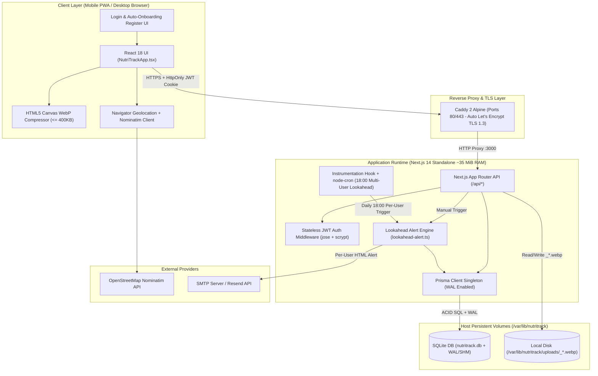
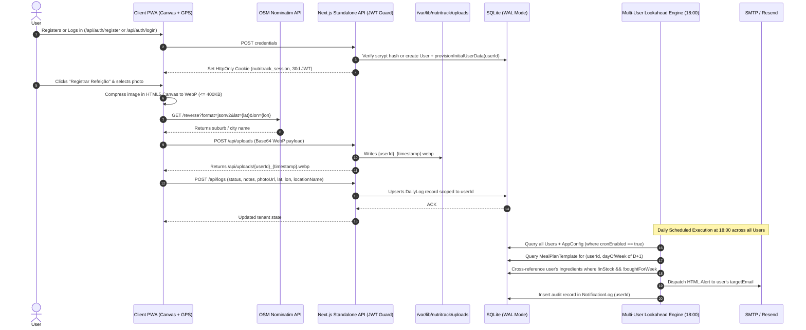
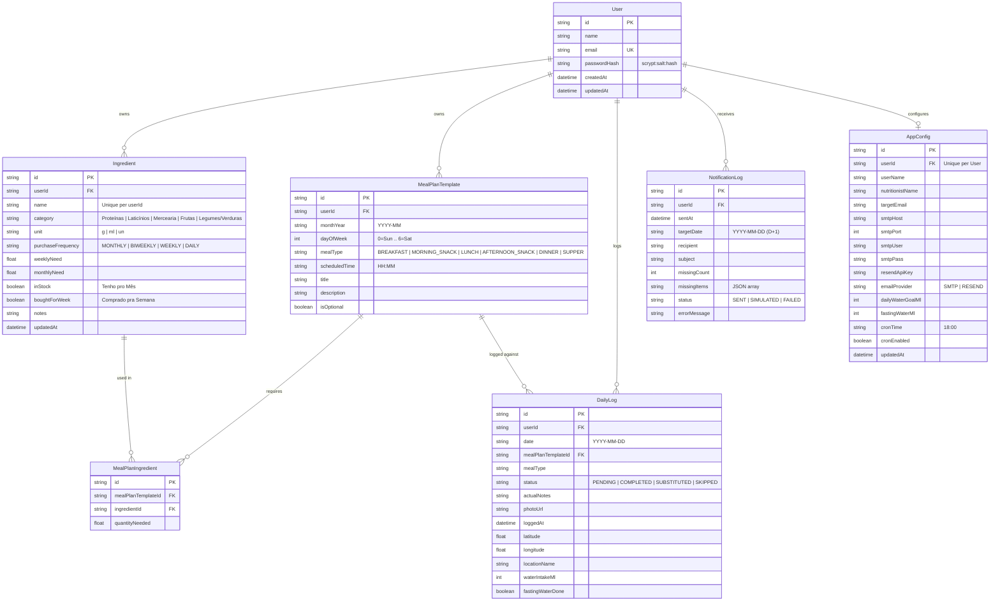

# Software Design Document (SDD) — NutriTrack-OS

- **Document ID:** `SDD-001-NUTRITRACK-OS` / `SDD-002-MULTI-USER-AUTH`
- **Version:** `2.0.0`
- **Status:** `Approved / Released`
- **Methodology:** Spec-Driven Development (SDD)

---

## 1. System Overview & Context

### 1.1. Purpose
**NutriTrack-OS** is a reactive, low-footprint multi-user full-stack web application designed to manage cyclic meal plans, personal food inventory, daily nutritional adherence (with geolocated photo evidence and hydration tracking), proactive lookahead grocery alerts, and clinical reporting for nutritionists. Each registered user operates in an isolated tenant workspace (`userId`).

### 1.2. System Actors & External Integrations
- **Authenticated User (Patient / Athlete):** Registers or logs in via stateless JWT session (`nutritrack_session`), manages daily water intake, logs meals with camera photos and GPS location, updates weekly/monthly meal templates, and tracks grocery stock checkboxes in complete isolation from other users.
- **Nutritionist (Clinical Reviewer):** Consumes the consolidated monthly executive report (adherence KPIs, hydration average, substitution justifications, and timestamped/geolocated meal photo gallery) via web view or printable PDF (`window.print()`).
- **Multi-Tenant Lookahead Cron Engine (Internal Actor):** Scheduled background worker (`node-cron`) that iterates over all active users at `18:00` daily and evaluates each user's `D+1` meal requirements against their personal stock.
- **OpenStreetMap Nominatim API (External Service):** Provides client-side reverse geocoding (`lat/lon` $\rightarrow$ neighborhood/city label) during meal check-in.
- **SMTP / Resend API (External Service):** Delivers per-user transactional HTML alert emails when ingredients required for tomorrow's meals are out of stock.

---

## 2. Architecture & Component Design

### 2.1. High-Level Container & Component Topology

### 2.2. Sequence Diagram — Multi-User Auth, Meal Check-in & Lookahead Alert Flow

---

## 3. Data Model Specification (ERD)

The multi-tenant relational schema is managed via Prisma ORM (`prisma/schema.prisma`) on top of SQLite in WAL mode:

---

## 4. Core Business Rules & Algorithms (Specs)

### `SPEC-01`: Lookahead Inventory Alert Engine (`src/lib/lookahead-alert.ts`)
- **Trigger:** Executed automatically by `node-cron` when server local time matches `AppConfig.cronTime` (default `18:00`) and `AppConfig.cronEnabled == true`, or manually via `POST /api/alerts/check`.
- **Algorithm:**
  1. Given `userId` and reference date $D$, compute target date $D_{+1} = D + 1\text{ day}$, its `monthYear` (`YYYY-MM`), and its `dayOfWeek` $\in \{0..6\}$.
  2. Fetch all `MealPlanTemplate` records matching `(userId, monthYear, dayOfWeek)` ordered by `scheduledTime ASC`, including their `MealPlanIngredient` links and associated `Ingredient` entities.
  3. Filter linked ingredients where:
     $$\neg \text{inStock} \land \neg \text{boughtForWeek}$$
  4. Aggregate `quantityForTomorrow` per missing ingredient across all meals of $D_{+1}$ and list the affected meal titles/times.
  5. Render a responsive HTML email table and dispatch via the user's configured provider (`SMTP` via `nodemailer` or `RESEND` via REST API). If credentials are not yet populated, record as `SIMULATED` and return the HTML preview to the UI.
  6. Persist an immutable audit entry in `NotificationLog` linked to `userId`.

### `SPEC-02`: Client-Side Media & Geo Pipeline (`src/components/NutriTrackApp.tsx`)
- **Image Compression Algorithm (`compressImageToWebP`):**
  1. Load user-selected image file into an HTML5 `Image` object via `FileReader`.
  2. Downscale dimensions proportionally so that $\max(\text{width}, \text{height}) \le 1200\text{ px}$ on an offscreen `<canvas>`.
  3. Encode canvas content to `image/webp` starting at quality $q = 0.82$.
  4. Iteratively decrement $q$ by $0.10$ (down to a floor of $0.35$) until the base64 byte payload satisfies:
     $$\text{Size}_{\text{WebP}} \le 390\text{ KB}$$
  5. Upload compressed payload to `POST /api/uploads`, which enforces a hard server-side ceiling of $500\text{ KB}$ and writes `<userId>_<timestamp>.webp` to `UPLOAD_DIR`.
- **Geolocation & Reverse Geocoding:**
  1. Invoke `navigator.geolocation.getCurrentPosition` with `enableHighAccuracy: true`.
  2. Query `https://nominatim.openstreetmap.org/reverse?format=jsonv2&lat={lat}&lon={lon}`.
  3. Extract `suburb || neighbourhood || city_district` and `city || municipality` to form a human-readable badge (or allow 1-tap selection from preset tags: `Casa`, `Trabalho`, `Pós-Treino / Academia`, `Restaurante`).

### `SPEC-03`: Dynamic Grocery Recalculation (`src/lib/seed-data.ts`)
- Whenever a `MealPlanTemplate` or its `MealPlanIngredient` links are created or updated (`POST /api/meals` or `PUT /api/meals`) for a given `(userId, monthYear)`:
  1. Query all `MealPlanTemplate` records for `(userId, monthYear)` across all 7 days of the week ($0..6$).
  2. Sum `quantityNeeded` per `ingredientId` to compute the exact weekly demand:
     $$\text{weeklyNeed}_i = \sum_{m \in \text{Week}} \text{quantityNeeded}_{m,i}$$
  3. Compute the monthly demand as:
     $$\text{monthlyNeed}_i = 4 \times \text{weeklyNeed}_i$$
  4. Persist updated `weeklyNeed` and `monthlyNeed` values in `Ingredient` for that `userId`.

### `SPEC-04`: Stateless Authentication & Auto-Onboarding (`src/lib/auth.ts` & `src/app/api/auth/*`)
- Passwords are hashed using Node.js native `crypto.scryptSync` (`scrypt:<saltHex>:<keyHex>`).
- Upon registration (`POST /api/auth/register`), `provisionInitialUserData(userId)` runs inside an atomic Prisma transaction (`prisma.$transaction`) to populate the new user's isolated 39 catalog ingredients, 42 weekly meal templates, sample logs, and `AppConfig`.
- Session state is carried in an `HttpOnly`, `Secure`, `SameSite=Lax` JWT cookie (`nutritrack_session`, 30-day validity) signed with `HS256` via `jose`.

### `SPEC-05`: Multi-Tenant Data Isolation (`userId` Guard)
- Every protected API route invokes `getAuthenticatedUser(req)` and returns `401 Unauthorized` if no valid session exists.
- Every Prisma query and mutation on `Ingredient`, `MealPlanTemplate`, `DailyLog`, `NotificationLog`, and `AppConfig` is strictly scoped by `userId: currentUser.id`.

### `SPEC-06`: Multi-User Lookahead Cron Loop (`src/instrumentation.ts`)
- The background cron job queries all registered `User` accounts and their `AppConfig`, executing `runLookaheadCheck(user.id)` independently for each user whose `cronEnabled` flag is active and whose configured `cronTime` matches the current `HH:MM`.

### `SPEC-07`: Authentication UI/UX & Tenant Identification (`src/components/NutriTrackApp.tsx`)
- Unauthenticated visitors are presented with a Mobile-First Login / Register screen featuring instant auto-onboarding feedback.
- Authenticated sessions display the logged-in user's name and email badge in the top navigation bar alongside a 1-click **Sair (Logout)** button, and dynamically inject the user's name into the Nutritionist Executive Report.

---

## 5. API Contracts (Interface Specification)

| Endpoint | Method | Purpose | Request Payload / Params | Response Summary |
| :--- | :--- | :--- | :--- | :--- |
| `/api/auth/register` | `POST` | Register new user & auto-provision 39 ingredients + 42 meals | `{ name, email, password }` | `201 Created` `{ user }` + `Set-Cookie: nutritrack_session` |
| `/api/auth/login` | `POST` | Authenticate existing user via email & password | `{ email, password }` | `200 OK` `{ user }` + `Set-Cookie: nutritrack_session` |
| `/api/auth/logout` | `POST` | Clear `nutritrack_session` cookie | `{}` | `200 OK` `{ ok: true }` |
| `/api/auth/me` | `GET` | Return currently authenticated user from JWT cookie | Cookie `nutritrack_session` | `200 OK` `{ user }` or `401 Unauthorized` |
| `/api/state` | `GET` | Fetch complete reactive state for authenticated user | `?date=YYYY-MM-DD&monthYear=YYYY-MM` | `{ user, ingredients, mealTemplates, monthLogs, config, notificationLogs, baseRecipes, tomorrowSummary }` |
| `/api/ingredients` | `PATCH` | Toggle `inStock` / `boughtForWeek` or bulk reset week (user-scoped) | `{ id, inStock?, boughtForWeek? }` or `{ action: "RESET_WEEK" }` | `{ ingredient }` or `{ ok: true }` |
| `/api/ingredients` | `POST` | Create new catalog ingredient for current user | `{ name, category, unit, purchaseFrequency, weeklyNeed }` | `{ ingredient }` |
| `/api/meals` | `PUT` / `POST` | Update or create meal template & recalculate user's needs | `{ id?, monthYear, dayOfWeek, mealType, scheduledTime, title, description, ingredients[] }` | `{ mealTemplate }` |
| `/api/logs` | `POST` | Log meal check-in (photo + GPS) or hydration update for user | `{ action?: "HYDRATION", date, mealPlanTemplateId?, status?, actualNotes?, photoUrl?, latitude?, longitude?, locationName?, waterIntakeMl?, fastingWaterDone? }` | `{ log }` |
| `/api/alerts/check` | `POST` | Trigger Lookahead D+1 check & email dispatch for current user | `{ date?: "YYYY-MM-DD" }` | `LookaheadResult` (`missingItems`, `status`, `htmlPreview`) |
| `/api/config` | `PUT` | Update current user's `AppConfig` (SMTP/Resend/Goals) | `Partial<AppConfig>` | `{ config }` |
| `/api/uploads` | `POST` | Persist compressed WebP meal photo prefixed with `userId` | `{ dataUrl: "data:image/webp;base64,..." }` or `multipart/form-data` | `{ url: "/api/uploads/<userId>_<ts>.webp", sizeBytes }` |
| `/api/uploads/[filename]` | `GET` | Serve persisted meal photo from disk volume | Path param `filename` | Binary `image/webp` with immutable cache headers |

---

## 6. Non-Functional Requirements (NFRs)

1. **Memory Footprint (`NFR-PERF-01`):** Application container resident set size (RSS) in production MUST remain below $60\text{ MiB}$ under multi-tenant workload (verified at $\sim 35\text{ MiB}$ for `nutritrack-app` and $\sim 13.4\text{ MiB}$ for `nutritrack-caddy`).
2. **Database Concurrency & Durability (`NFR-DATA-01`):** SQLite MUST initialize with `PRAGMA journal_mode=WAL;`, `PRAGMA synchronous=NORMAL;`, and `PRAGMA busy_timeout=5000;` so concurrent multi-user reads and cron checks never block UI writes.
3. **Storage Efficiency (`NFR-STOR-01`):** Every uploaded meal photo MUST be compressed client-side to WebP $\le 400\text{ KB}$ (and rejected server-side if $> 500\text{ KB}$), allowing over $100,000$ meal photos within a 64 GB Free Tier P6 SSD disk.
4. **Transport & Session Security (`NFR-SEC-01`):** Production traffic MUST be served over HTTPS (TLS 1.2/1.3) via Caddy automatic Let's Encrypt certificates, and session cookies MUST enforce `HttpOnly`, `Secure`, and `SameSite=Lax`.
5. **Zero-Data-Loss Migration (`NFR-OPS-02`):** Upgrading a single-user SQLite database to the multi-user schema MUST automatically preserve and link all existing records to the primary owner account via `prisma/migrate-multi-user.mjs`.
